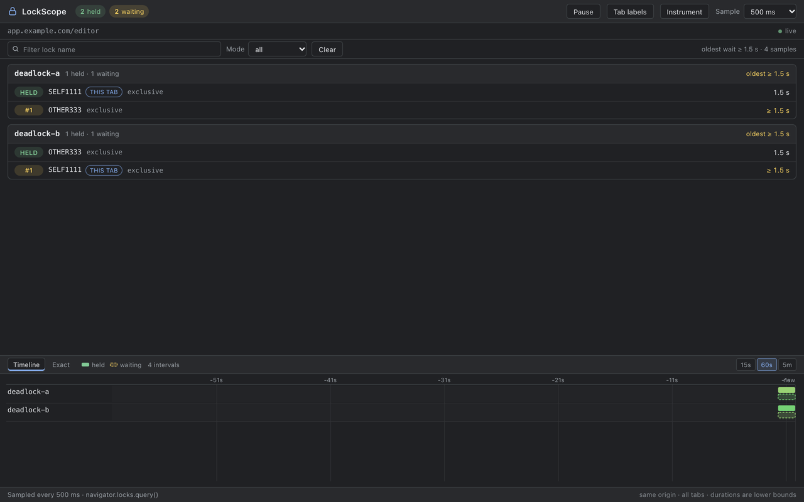

# LockScope

**A Chrome DevTools panel for the Web Locks API.**

[](#install)
[](LICENSE)
[](https://github.com/hashimlokasher/lockscope/actions/workflows/ci.yml)

**Current version:** 0.6.0 · [Changelog](CHANGELOG.md) · [Source](https://github.com/hashimlokasher/lockscope)

LockScope shows every lock held or requested by the inspected origin — across
tabs — with holders, FIFO waiters, observed durations, and a live timeline.
`navigator.locks.query()` is a point-in-time array with no timestamps or events;
LockScope makes that state observable.



## Features

- **Contention lanes** by lock name, with holders and waiters numbered `#1`, `#2`, …
- **Observed durations** for holds and waits, explicitly labelled as lower bounds.
- **Timeline** with solid held bars, dashed waiting bars, hover details, and
  15 s / 60 s / 5 min windows.
- **Filters and history** by lock name or mode; pause without counting the gap;
  clear without losing the current lock set.
- **`this tab` badge** from a short-lived probe lock.
- **Optional tab labels** — after a click and a per-origin permission grant, rows
  show which tab owns each lock.
- **Optional instrumentation** — patches `LockManager.request` for exact
  request/acquire/release times and await-site stacks; reversible.
- **Ten demo scenarios** including abort, `ifAvailable`, `steal`, worker-held
  locks, and a two-tab deadlock.

## Install

### From source (development)

```bash
cd lockscope
python3 -m http.server 8080 --directory demo   # demo page
```

1. Open `chrome://extensions`.
2. Enable **Developer mode**.
3. Choose **Load unpacked** and select `extension/`.
4. Open `http://localhost:8080/`, then DevTools → **LockScope**.

No build step and no dependencies.

### Store package

```bash
npm run package   # dist/lockscope-<version>.zip
```

The archive contains only `extension/` contents. Store copy, screenshots, and the
privacy policy live in [`store/`](store/).

## Usage

- **Queue 3** on the demo page: one holder and three waiters with growing `≥` waits.
- **Start deadlock**: opens a second tab; release from either side to unwind it.
- **Tab labels**: requests `scripting` + the inspected origin, then labels holders
  with tab titles. Toggle off to hide them.
- **Instrument** → **Exact**: exact timings and stacks for main-world lock
  requests. Toggle off to restore the native method.

Keyboard: `P` pauses/resumes, `/` focuses the filter, `Esc` clears it.

## Permissions and privacy

The base extension has **zero required permissions** — only `devtools_page`.

- **Tab labels** are optional: `optional_permissions: ["scripting"]` plus
  `optional_host_permissions` for HTTP(S). Chrome asks only after the button
  click, only for the inspected origin.
- **Instrumentation** needs no permission but patches the inspected page. It is
  off by default, main-world only, and reversible.

Everything runs locally: no network requests, analytics, accounts, or persistence
of lock names, tab titles, or stacks. See the
[privacy policy](store/privacy-policy.md).

## Development

Requirements: Chrome 120+, Node.js 20+, Python 3 (demo server).

| Command | Purpose |
| --- | --- |
| `npm test` | Unit tests for the model, timeline intervals, instrumentation, and formatting |
| `npm run check` | `node --check` every script |
| `npm run demo` | Serve the demo at `http://localhost:8080` |
| `npm run package` | Build `dist/lockscope-<version>.zip` (needs `zip`) |

See [CONTRIBUTING.md](CONTRIBUTING.md) for the full workflow and
[docs/manual-tests.md](docs/manual-tests.md) for the manual test sheet.

## Project structure

```
extension/           Manifest V3 extension (no build step)
  panel/             Lanes, tabs/instrumentation controllers, model, timeline
  page-agent.js      Sampling agent injected into the inspected page
  instrument.js      Opt-in LockManager.request instrumentation
demo/                Web Locks demo page and worker
test/                Node test runner suites
docs/                Plan, verification notes, manual tests
store/               Chrome Web Store listing, privacy policy, screenshots
site/                Public landing and privacy page (GitHub Pages)
scripts/             Packaging script
.github/             CI, Pages deploy, issue forms, PR template
```

## Hosted policy

The [privacy site](https://hashimlokasher.github.io/lockscope/) is deployed by
[`.github/workflows/pages.yml`](.github/workflows/pages.yml). Once Pages is
enabled, use `https://<owner>.github.io/<repo>/privacy.html` in the store listing.

## Documentation

- [Project plan and milestones](docs/plan.md)
- [Verification notes](docs/verification.md)
- [Manual test sheet](docs/manual-tests.md)
- [Changelog](CHANGELOG.md)

## Contributing

Issues and pull requests are welcome. Please run `npm test` and `npm run check`
before opening a PR, and follow [CONTRIBUTING.md](CONTRIBUTING.md) and the
[Code of Conduct](CODE_OF_CONDUCT.md). For security reports, see
[SECURITY.md](SECURITY.md).

## License

[MIT](LICENSE) © 2026 Hashim
